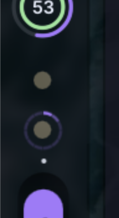

# claude-agent-lights

One status light per running [Claude Code](https://claude.com/claude-code) session,
for a desktop bar. Start an agent in tmux, walk away, and glance at the bar to see
which session needs you, and click the light to go straight back to it.



| Light | Meaning |
|---|---|
| 🔴 red, blinking (1 s) | waiting on you: a permission prompt or a question |
| 🟡 yellow, slow blink (1.8 s) | working |
| 🟢 green, breathing | finished, and you haven't been back to it yet |
| (gone) | finished and visited, or idle for over 12 h |

- **Hover:** session name, folder, state and how long it has been in it, the
  plan and its progress, and each running subagent's description.
- **Click:** switches tmux to that session's pane and focuses the terminal
  window. That also counts as a visit, so a green light goes away.
- **Plan ring:** a session running a multi-task plan gets a segmented ring
  around its light. Each arc is one task: lit = done, half = the current task,
  faint = still to do. Above 12 tasks it becomes one continuous arc.
- **Subagent dots:** one tiny dot per running subagent, in a row under the
  light (up to 4, then "+").

- **Repo stripe:** a thin stripe beside each light in its repo's colour, so you
  can tell which project a session belongs to. A worktree counts as its main
  repo. Right-click a light to pick the colour.

It needs no Claude Code hooks or configuration. Everything comes from files
Claude Code already writes.

## How it works

`core/agent_lights.py` is the engine: Python 3, stdlib only. A bar widget
runs `agent_lights.py scan` every 2 s and draws the JSON it prints. Clicking a
light runs `agent_lights.py jump <pid>`.

| Data | Where Claude Code keeps it |
|---|---|
| Live sessions: `status` (busy / waiting / idle), name, cwd, tmux pane | `~/.claude/sessions/<pid>.json` |
| Which plan a session runs | its transcript `~/.claude/projects/*/<sessionId>.jsonl`: the last plan folder (`YYYY-MM-DD-name`) named in its own `plan-log` tool calls |
| Plan progress | `docs/plans/<slug>/plan.md` (`### N.` or `### Task N:` headings) + `log.md` (`progress · Task N done`) + a superpowers `.superpowers/sdd/*/progress.md` ledger (`Task N: complete`) |
| Running subagents | `~/.claude/projects/*/<sessionId>/subagents/*.meta.json` (`finished: false`, active in the last 30 min) |

Visits are stored in `~/.local/state/agent-lights/seen.json`. A byte-offset
cache, `cache.json`, means a scan reads only the new part of each transcript.

The plan ring follows the lean-skills `lean-plan` /
`lean-execute` and superpowers plan conventions. A session that doesn't run a
plan just gets a plain light.

**Caveat:** these are undocumented Claude Code internals, tested with Claude
Code 2.1.325, so an update can change them. All the parsing is in one file, and
`tests/` shows exactly what's expected.

### `scan` output

```json
[{"pid": 3327433, "name": "my-app-a3", "cwd": "/home/me/repos/my-app",
  "tmux": "17:@21.%38", "light": "busy", "since": 1794774902834,
  "plan": {"name": "refactor", "total": 12, "done": 1,
           "states": ["done", "current", "todo", "..."]},
  "subagents": ["Implement Task 2: parser fixes"],
  "repo": "my-app", "repoColor": "#89b4fa"}]
```

`light` is one of `waiting`, `done` or `busy`; lights are sorted in that order.
Each light also has `"repo": "my-app", "repoColor": "#89b4fa"`.
`plan` is `null` when the session isn't running a plan.

## Repo colours

Each repo gets a colour from a 9-colour palette that leaves out red, yellow and
green, because those mean session state. The palette is `blue`, `sapphire`,
`sky`, `teal`, `lavender`, `mauve`, `pink`, `peach` and `flamingo` (Catppuccin
Mocha). A repo you haven't set gets an automatic colour from its name, which is
the same on every machine. To set one:

```sh
core/agent_lights.py color my-app teal       # or any #rrggbb
core/agent_lights.py color my-app auto       # back to automatic
core/agent_lights.py palette                 # the named colours as JSON
```

Choices are stored in `~/.config/agent-lights/colors.json` (or under
`$XDG_CONFIG_HOME`), as `{"my-app": "teal"}`. Any UI that reads `scan` gets the
same colours, so copy that file to keep them consistent across machines. The
repo name is the folder that holds the git repo, or for a session outside git,
the session's folder name.

## Install (Omarchy)

```sh
omarchy/install.sh
```

Then add `{"id": "tanderson.agent-lights"}` to a bar section in
`~/.config/omarchy/shell.json`. The optional settings in that entry are
`"intervalMs"` (default 2000) and `"maxLights"` (default 8, then "+n"). The widget
is built for a vertical rail and also works on a horizontal bar.

## Other platforms

Only four small functions in the *Platform* section of `core/agent_lights.py`
are Linux-specific:
- `proc_start` / `is_alive`: the process liveness check, via `/proc`
- `focus_terminal`: focusing the terminal window, via Hyprland
- `notify`: notifications, via `notify-send`

Replace those and write a UI for your bar (on macOS, for example, a SwiftUI
`MenuBarExtra`). Everything else carries over.

## Tests

```sh
python3 -m unittest tests/test_agent_lights.py
```

## License

MIT
